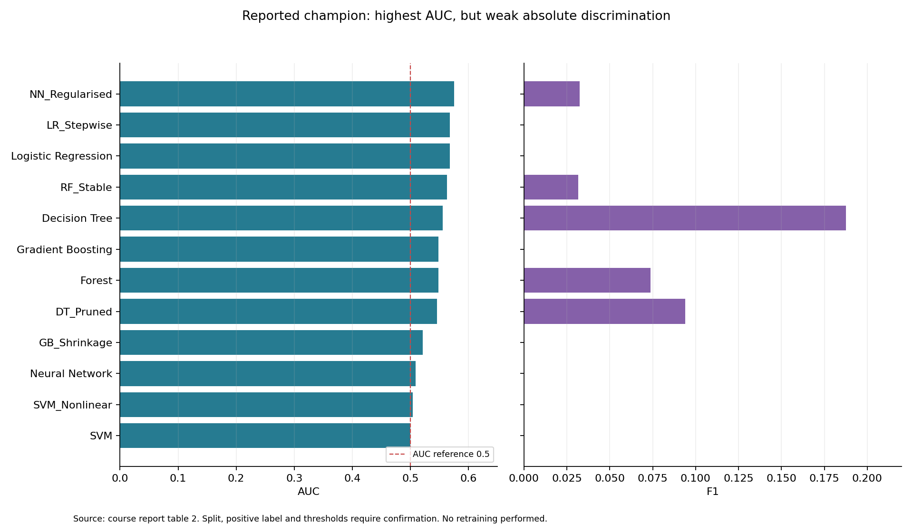

# Credit Risk Model Evaluation | 信用风险模型评估与评分

**Decision question:** Can a predictive score support prioritization of applications for human review? This coursework project prepared German-credit-style data, compared classification model families in SAS, registered the selected model in SAS Model Manager and ran a 100-record scoring test.

**决策问题：** 模型评分能否辅助决定哪些信贷申请需要优先人工复核？本课程项目准备了德国信用风险风格数据，在 SAS 中比较分类模型，并在 SAS Model Manager 中注册选中模型，完成 100 条记录的评分测试。

## Evidence / 已有证据

**Authorship:** I completed this coursework independently. / **完成方式：** 本课程项目由我独立完成。

The report compares Logistic Regression, Decision Tree, Random Forest, Gradient Boosting, SVM and Neural Network, including modified configurations. The chosen `NN_Regularised` model used one hidden layer with 10 neurons. The report's comparison table gives **AUC 0.5754, KS 0.1340, accuracy 0.7000 and F1 0.0323**. Its advantage over logistic regression (AUC 0.5678) was small. The low AUC and F1 make the model unsuitable as evidence for automatic approval or rejection. Accuracy near 70% is especially weak evidence when the dataset summary shows a 70/30 class split.

报告比较了逻辑回归、决策树、随机森林、梯度提升、支持向量机和神经网络，以及部分修改配置。选中的 `NN_Regularised` 为单隐层、10 个神经元。报告表中 **AUC 0.5754、KS 0.1340、准确率 0.7000、F1 0.0323**；相对逻辑回归（AUC 0.5678）的提升很小。低 AUC 和 F1 不足以支持自动审批或拒绝；数据约 70/30 的类别比例也让 70% 准确率缺少说服力。

The course report documents SAS Model Manager registration and a completed scoring test. The output contains 100 unique `Customer_ID` values and `EM_EVENTPROBABILITY`, with values about 0.159–0.496. This demonstrates a course scoring workflow, not production deployment. The output file contains application attributes, so it is omitted from this public package.

课程报告记录了 SAS Model Manager 注册和评分测试。输出包含 100 个唯一 `Customer_ID` 及 `EM_EVENTPROBABILITY`，概率约 0.159–0.496。这是课程评分流程，并非生产部署。评分文件含申请属性，因此未放入公开包。

## Product interpretation / 产品解读

Read the [model decision review / 模型选型复盘](model-decision-review.md) for the **0.0076 AUC difference** versus logistic regression, the majority-class baseline caveat, and a proposed review-capacity evaluation. This is a new interpretation of reported results, not additional trained-model performance.

If future validation justified use, a human-review tool could display ranked applications, case context and model uncertainty. The **proposed** workflow would require a defined review capacity, threshold trade-offs, false-negative costs, fairness checks, monitoring and an override log. None of these interface or operations features were implemented in the coursework.

如后续验证支持使用，可设计人工审核工具，展示待审申请排序、个案信息与模型不确定性。这个**新增产品设想**需要先定义审核容量、阈值取舍、漏检成本、公平性检查、监控与人工改判记录；课程并未实现这些界面和运营功能。

## Reproducibility and limits / 复现与边界

- The SAS project and screenshots in the coursework report are the source of the reported metrics. No runnable SAS project export is included here; training results cannot currently be reproduced from this package alone. / 指标来自课程报告中的 SAS 项目和截图；目前没有可运行的 SAS 工程导出，公开包无法独立重训。
- The A2 file contains 8,000 rows. Its relationship to the original German credit data and synthetic generation process needs to be documented before release. A Colab script in the source directory uses placeholders and notebook syntax, so it is not presented as a ready-to-run pipeline. / A2 文件有 8,000 行；与原始数据及合成过程的关系仍需确认。源目录的 Colab 脚本含占位符和 notebook 语法，暂不作为可运行流程发布。
- Before any operational use, confirm event-label direction, train/validation/test split, leakage controls, calibration, confusion matrix, precision and recall at review-capacity thresholds, and fairness by relevant groups. / 应用前需核对事件标签、数据切分、泄漏控制、校准、混淆矩阵、不同审核容量下的 precision/recall，以及分组公平性。
- This is a model-evaluation case, not a search, advertising or recommendation system. / 本项目是模型评估案例，不是搜索、广告或推荐系统。

**Publication note / 发布说明:** confirm source-data rights before adding diagrams or datasets. / 添加流程图或数据集前，核实数据授权。

See [reported model metrics](model-comparison.csv) and the [human review concept](product-note.md). / 参见[报告指标表](model-comparison.csv)与[人工审核产品设想](product-note.md)。
