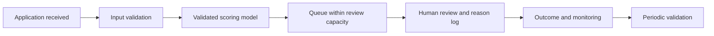

# Model decision review | 模型选型复盘

## Decision / 决策结论

**The reported champion is a candidate for further validation, not an approval engine.** Ranking first among the tested configurations does not establish useful absolute performance. This review interprets the existing course report; it does not introduce new training results.

**相对冠军不等于达到可用标准。** 本页基于已有报告指标进行新增复盘，没有重新训练模型，也没有验证真实审批收益。

Source: [reported metrics](model-comparison.csv). Evaluation split and event-label direction still require confirmation from the SAS project. Chart values are report transcriptions, not independent replication.

## Three trade-offs / 三个取舍

| Question | Evidence | Interpretation |
|---|---|---|
| Does complexity buy a clear improvement? | NN_Regularised AUC 0.5754 versus logistic regression 0.5678; difference **0.0076** | A small reported difference. Without paired predictions and uncertainty estimates, superiority is not established. Compare reproducibility, maintenance and interpretability before preferring the neural network. |
| Is 70% accuracy useful? | Summary class balance is approximately 70/30; champion accuracy is 0.7000 | A majority-class classifier would have about 70% accuracy **if that balance holds in the evaluation split**. Exact baseline performance on that split remains unverified. |
| Which metric should choose the model? | Decision Tree F1 0.1877 versus champion F1 0.0323; tree AUC 0.5552 | Ranking discrimination and thresholded decisions answer different questions. The F1 comparison needs confirmation of positive label and operating threshold. Neither number alone establishes business value. |

相对逻辑回归的 AUC 差为 0.0076，即 0.76 个百分点，不是“提升 0.76%”的相对增幅。F1 为零也不能仅凭汇总表确定模型从不预测正类，需要检查预测和混淆矩阵。

## Proposed validation gate / 下一步验证门槛

1. **Recover the evaluation context.** Confirm risk label, probability direction, split, threshold and synthetic-data generation sequence. If synthetic samples were generated before splitting, investigate leakage before reusing the metrics.
2. **Establish baselines.** Calculate exact majority-class accuracy and compare random ordering and logistic regression using the same held-out cases. Do not use the 100-record scoring output as an evaluation set unless reliable ground-truth labels are available.
3. **Evaluate at review capacity.** For N cases, choose k = ceiling(capacity × N), rank by confirmed risk probability and define a deterministic tie rule. Report precision@k = risky cases in queue / k; recall@k = risky cases in queue / all risky cases; lift@k = precision@k / test-set risk prevalence. Recall is undefined if there are no risky cases; lift is undefined at zero prevalence.
4. **Quantify uncertainty and costs.** Use paired resampling of independent cases, or clusters if cases repeat, to compare models. Specify false-negative and review costs as assumptions; do not invent costs from these data. Inspect calibration and subgroup performance before any operational trial.

在 5%、10%、20% 审核容量下比较模型，才更接近“审核人员应先看哪些申请”的问题。目前没有足够证据填写这些结果，保留为验证计划。

## Proposed queue / 拟议审核流程

This diagram is a proposed extension. Only the course model registration and scoring test are documented as completed. The queue, monitoring and outcome feedback are not implemented.

## Interview explanation / 面试讲述

“我独立完成了课程中的信用风险模型比较和 SAS 评分流程。整理作品时，我发现冠军模型的 AUC 只有 0.5754，准确率也接近约 70% 的多数类基线，因此没有把它描述为可用于自动审批的成果。我进一步区分了排序指标与阈值指标，并提出按人工审核容量验证风险覆盖率的方案。该方案目前尚未实现。”
