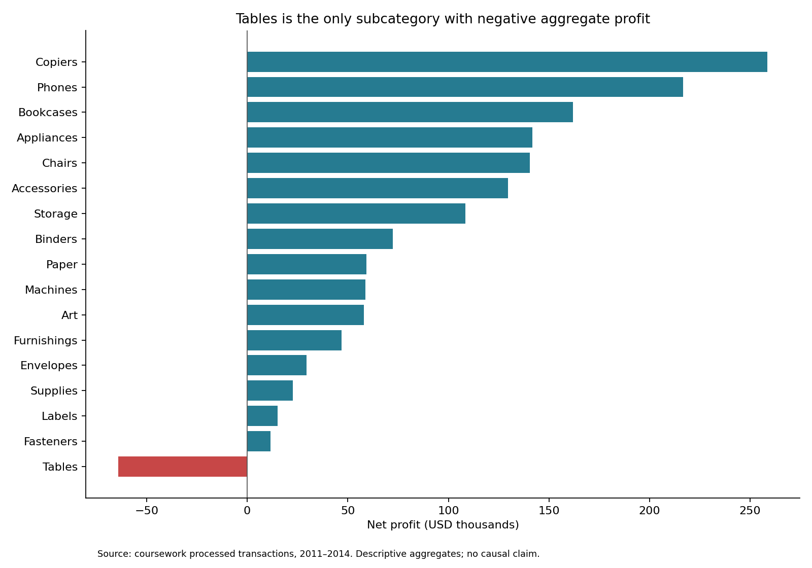
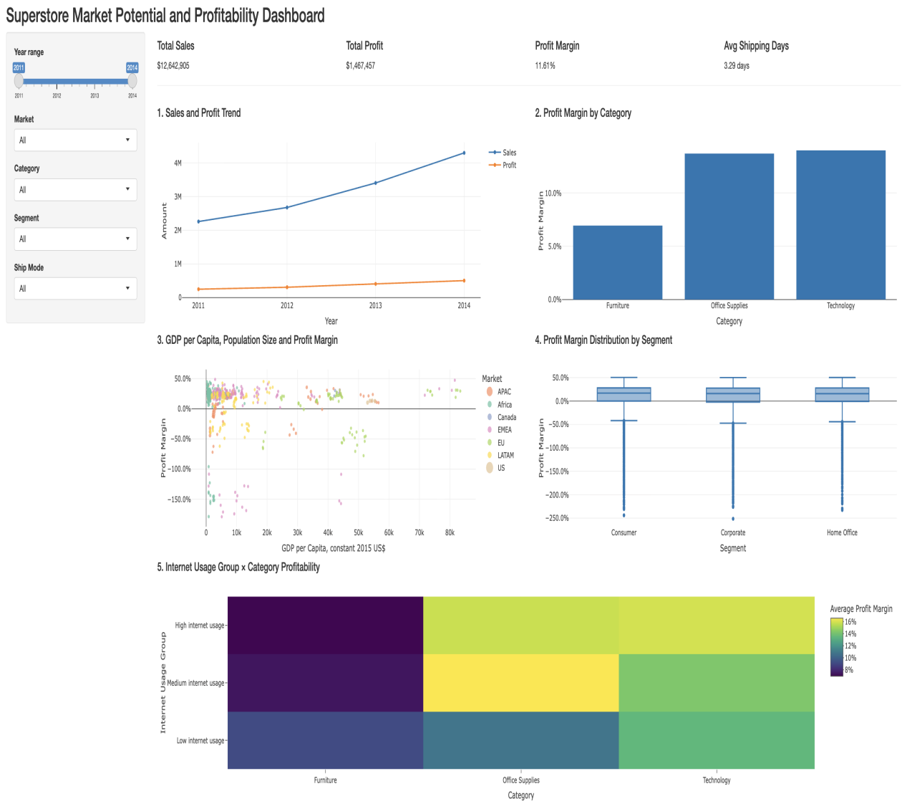

# Retail Profitability Dashboard | 跨境电商利润分析与可视化看板

**Decision question:** Where should a retailer investigate expansion or operational problems when revenue growth alone hides margin risk? This coursework dashboard joins Superstore transactions with World Bank GDP per capita, population and internet-use indicators for 2011–2014. It lets an analyst filter by year, market, category, customer segment and shipping mode.

**决策问题：** 当销售额增长掩盖利润率风险时，零售商应该优先调查哪些市场和品类？本课程项目将 2011–2014 年 Superstore 交易数据与世界银行人均 GDP、人口、互联网使用率指标结合，支持按年份、市场、品类、客户群体和配送方式筛选。

## What I built / 项目内容



**New portfolio evidence / 新增复核：** Recomputed **51,290 transaction rows**: overall margin **11.61%**; Tables net profit **−$64,083.39**. Orders containing any loss-making row account for **30.16%**, while orders with negative total profit account for **24.54%**. These are different definitions, calculated over the complete local processed file.



Read the [aggregate findings and full tables](analysis-findings.md), download the [aggregate evidence](retail-evidence.csv), or inspect the [reproducible Python analysis](analyze_retail.py). No customer-level data is published. The figure is an analysis chart, not a Shiny screenshot.

- Interactive R Shiny dashboard with five visualizations: sales and profit trend, category margin, loss-making subcategories, country profitability versus GDP and population, and digital-readiness by category. / 包含五组可交互图表的 R Shiny 看板。
- Country-name normalization, country-year joins, derived profitability and shipping metrics. / 国家名称统一、国家年份关联、利润和配送指标计算。
- A written analysis translating patterns into questions for pricing, discounts, shipping and market selection. / 将图表发现转化为定价、折扣、配送及市场选择的待验证决策。
- Power BI-ready aggregate tables, DAX measures and a three-page build specification using the same metric contract. / 提供同口径的 Power BI 聚合表、DAX 指标与三页搭建说明。

**Authorship:** I completed this coursework independently. / **完成方式：** 本课程项目由我独立完成。

**Coursework result:** the report recorded sales growing from about $2.26m in 2011 to $4.30m in 2014 while overall profit margin moved from about 11.02% to 11.72%. Furniture had a lower aggregate margin than Technology and Office Supplies; Tables stood out as a loss-making subcategory. These are descriptive results from the assignment dataset, not causal or live-business impact claims.

**课程结果：** 报告记录的销售额从 2011 年约 226 万美元增长到 2014 年约 430 万美元，而整体利润率约从 11.02% 变为 11.72%。家具品类总体利润率低于科技产品和办公用品，Tables 子品类表现为亏损。以上是课程数据的描述性分析，并非因果结论或线上收益。

## Product interpretation / 产品解读

The primary user is a commercial analyst or category manager. The dashboard supports a review workflow: choose a period and market, compare aggregate margin with sales growth, drill into category and segment, then inspect country-level context. A decision to expand, cut discounts or change fulfillment would still require sample-size checks and controlled validation.

主要用户是商业分析师或品类经理。使用路径是选择时间与市场、比较增长和总体利润率、下钻品类与客群，再查看国家层面的外部环境。是否扩张、调整折扣或改变履约方式，仍需要样本量检查和进一步验证。

**Metric definition / 指标口径:** profit margin = sum(profit) / sum(sales), calculated over the active filters. `Loss_Order_Rate` is the share of orders containing at least one loss-making row in each country-year aggregate. The country chart now follows all active filters. These two items were corrected during portfolio preparation; the source coursework report has not been retroactively changed.

**Limitations / 局限：** Internet usage and GDP are country-level context, not proof that they cause retail profitability. The dashboard contains no experiment or user behavior data. Country matching and missing external indicators require review before business use. The boxplot reflects grouped data, so its distribution is over grouped cells rather than raw orders.

## Run locally / 本地运行

The R Shiny app now runs against the committed, privacy-preserving aggregate CSVs. It requires R plus `shiny`, `dplyr`, `readr`, `plotly` and `scales`.

```r
install.packages(c("shiny", "dplyr", "readr", "plotly", "scales"))
shiny::runApp(".")
```

To rebuild the aggregates from the original local coursework output without modifying it, run:

```sh
Rscript scripts/prepare_portfolio_data.R /path/to/processed_superstore_clean.csv
```

The script reads the processed course data and emits only grouped records; it excludes customer names, customer IDs and order IDs. / 看板使用仓库内的去标识化聚合数据直接运行；需要从原作业复建时，脚本只读取原数据并输出聚合记录，不改写原作业，也不输出客户或订单标识。

## Power BI implementation / Power BI 实现

The repository includes the same aggregate tables used by the R Shiny application, a [DAX measure set](powerbi/measures.dax), and a [three-page Power BI build guide](powerbi/BUILD.md). Profit margin and shipping-day measures use weighted definitions documented in [the data dictionary](data/DATA_DICTIONARY.md).

This macOS environment does not include Power BI Desktop, so no unverified `.pbix` file or Power BI screenshot is claimed. Decompress `market_category_metrics.csv.gz`, import it with `market_context.csv` in Windows Power BI Desktop, and follow the build guide to save `Superstore_Market_Profitability_Dashboard.pbix`. / 当前环境不含 Power BI Desktop，因此仓库不伪造 PBIX 或截图；可按说明解压数据后在 Windows Power BI Desktop 导入并保存。

**Publication note / 发布说明:** no live deployment or real-world outcome is asserted. / 本项目不宣称已上线或产生实际业务收益。

See [decision workflow](product-note.md) for the metric contract and proposed next steps. / 指标口径与后续设计见[决策流程](product-note.md)。
